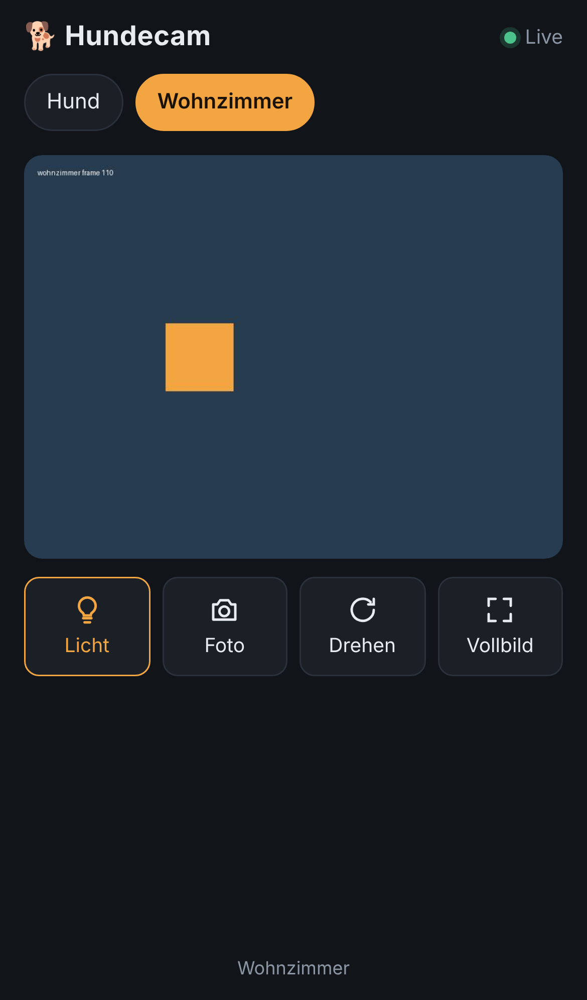

# Hundecam

Kleine Handy-Seite für eine oder mehrere ESP32-CAMs (Prusa-Firmware). Sie ist nur in deinem Tailnet erreichbar:
`https://cam-o-mat.<dein-tailnet>.ts.net`

```
Handy (Tailscale-App) ──HTTPS──▶ tailscale ──▶ Caddy :8080 ──▶ Seite (web/)
                                                  ├─▶ go2rtc ──▶ ESP32 /stream.mjpg (Stream, verteilt an alle Zuschauer)
                                                  └─▶ ESP32 /light (Licht an/aus)
```



**Funktionen:** Live-Bild, Umschalten zwischen Kameras, Licht an/aus, Foto speichern, Bild um 180° drehen, Vollbild (Handy quer halten = nur Bild).
Wenn die App im Hintergrund ist, pausiert der Stream. Fällt eine Kamera aus, verbindet sich die Seite automatisch neu.

## Voraussetzungen

- Ein Gerät im Heimnetz, das dauerhaft läuft und Docker hat (Raspberry Pi, NAS, Server)
- In der Tailscale-Admin-Konsole unter **DNS** sind **MagicDNS** und **HTTPS Certificates** aktiviert
- Die ESP32-CAM hat eine feste IP (im Router reservieren)

## Einrichten auf Proxmox (empfohlen)

In der Shell des Proxmox-Hosts als root:

```sh
bash -c "$(curl -fsSL https://raw.githubusercontent.com/Marcel-B/cam-o-mat/main/deploy/proxmox/cam-o-mat-lxc.sh)"
```

Das Skript legt einen kleinen unprivilegierten Debian-LXC `cam-o-mat` an (1 Kern, 512 MB, 4 GB), installiert Docker, holt dieses Repository nach `/opt/cam-o-mat`, fragt nach dem Tailscale-Auth-Key (und optional nach dem Passwort der Kamera) und startet alles. Am Ende prüft es Container, Kameras und Seite und zeigt die Tailnet-Adresse. Tailscale läuft im Container im Userspace, am Proxmox-Host ist dafür nichts einzustellen.

| Befehl | Was passiert |
| --- | --- |
| `cam-o-mat-lxc.sh` | alles: Container anlegen, App einrichten |
| `cam-o-mat-lxc.sh update` | `main` holen, neue Abbilder ziehen, neu starten (nach einer Kamera-Änderung im Repo) |
| `cam-o-mat-lxc.sh pruefen` | Container, Kameras und Tailnet-Adresse prüfen |
| `cam-o-mat-lxc.sh logs` | die letzten Zeilen von tailscale, go2rtc und caddy |

Ohne Container-ID nimmt das Skript den Container namens `cam-o-mat`. Weitere Einstellungen über Umgebungsvariablen, siehe `--help` (z. B. `IP=192.168.2.60/24 GATEWAY=192.168.2.1`).

## Einrichten von Hand (beliebiger Docker-Rechner)

1. Dieses Repository auf das Gerät klonen.
2. Die Kamera `hund` ist mit `192.168.2.134` schon eingetragen (`go2rtc.yaml` und `Caddyfile`). Ändert sich die IP, dort anpassen.
3. `.env.example` nach `.env` kopieren und einen Auth-Key eintragen (https://login.tailscale.com/admin/settings/keys).
4. `docker compose up -d`
5. Auf dem Handy mit Tailscale `https://cam-o-mat.<dein-tailnet>.ts.net` öffnen und „Zum Home-Bildschirm“ hinzufügen.

## Weitere Kamera hinzufügen

Für jede Kamera eine Zeile in `go2rtc.yaml` und eine in `Caddyfile`, beide mit demselben Namen:

```yaml
# go2rtc.yaml
  wohnzimmer: exec:sh /config/esp-mjpeg.sh http://192.168.2.135/stream.mjpg
```
```
# Caddyfile
	import cam wohnzimmer 192.168.2.135
```
Danach `docker compose restart`. Die Seite zeigt die neue Kamera automatisch an.

## Tipps für die ESP32-CAM

- In der Kamera-Weboberfläche ein Passwort setzen (Basic Auth) und es in `.env` als `CAM_BASIC_AUTH` eintragen, damit nur der Server das Licht schalten kann. Achtung: Den Stream selbst schützt die Firmware nicht mit dem Passwort. Er bleibt im Heimnetz offen.
- Den Prusa-Connect-Token leer lassen, dann lädt die Kamera nichts zu Prusa hoch.
- Auflösung SVGA oder XGA ist ein guter Kompromiss aus Bildqualität und Bildrate.
